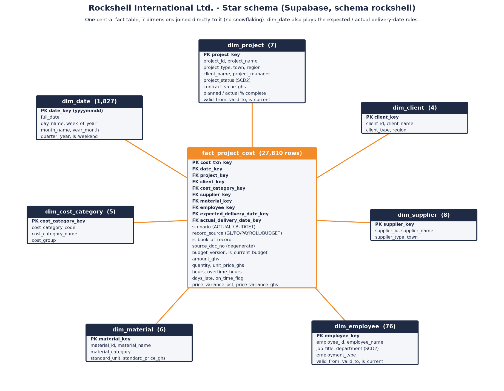

# Rockshell International Ltd. Data Warehouse

A data warehouse and live dashboard built as GIMPA Data Warehousing & Mining coursework for Rockshell International Ltd., a Ghanaian construction company. **All data is synthetic.**

**Live dashboard:** https://rockshell-dw.afriyierodney64.workers.dev

## Architecture
```
Operational sources (GL, procurement, payroll, HR, site reports, budgets)
      │  Python ETL: cleansing rules R1–R7, deduplication, ID recovery, reconciliation
      ▼
Star schema on Supabase PostgreSQL 17, schema `rockshell` (private)
      │  KPI views → one read-only function public.rockshell_dashboard() (aggregates only)
      ▼
Cloudflare Worker: serves the dashboard and proxies the function (key kept as a Worker secret, 60 s edge cache, offline fallback)
      ▼
Browser dashboard (Chart.js, simple report style, mobile friendly)
```



## Star schema
`fact_project_cost` has one row per project cost transaction (GL postings, PO lines, timesheet lines and budget lines, told apart by `record_source` and `scenario`). It joins directly to seven dimensions: date, project, client, supplier, material, cost category and employee. There is no snowflaking. Project and employee are SCD Type 2. Totals use only the book-of-record rows (GL and budget), so the PO and payroll detail is never double-counted. See [supabase/README.md](supabase/README.md) for the grain, the view-to-KPI mapping and the verified figures.

## Dashboard pages
Overview (headline KPIs, CPI by project, monthly spend) · Projects (forecast over/under budget, category spend, earned value table; project filter) · Suppliers (on-time and price premium) · Data Quality (132 duplicates removed, 145 IDs recovered, 32 rejected, 5/5 reconciliations) · Star Schema

Design: flat report style with one main colour (navy) and orange only for the problem item, direct data labels, and takeaway chart titles.

## Security
* The raw tables live in schema `rockshell`, which is not exposed by the Supabase Data API. RLS is on with no policies, and anon and authenticated have no grants.
* The only public surface is `public.rockshell_dashboard()`: STABLE, `search_path=''`, returns aggregated KPI JSON, and EXECUTE is granted to `anon` only.
* The browser talks only to the Worker. The Supabase key is a Worker secret.

## Repository layout
| Path | What |
|---|---|
| `supabase/migrations/` | 01 star schema · 02 KPI views · 03 index fix · 04 dashboard API function |
| `supabase/loader/` | Extracts cleaned rows from the ETL database into batched INSERTs; draws the ERD |
| `supabase/data_batches/` | Batched INSERT files used for the load (synthetic data) |
| `dashboard/public/` | Front end (HTML, CSS, JS, Chart.js, ERD, offline data copy) |
| `dashboard/src/worker.js` | Cloudflare Worker |
| `dashboard/build_deploy.py` | Builds the Cloudflare API upload (reads `SUPABASE_URL` and `SUPABASE_KEY` from the environment) |

## Re-deploying
1. Apply `supabase/migrations/*.sql` in order, then run the `supabase/data_batches/*.sql` files in order.
2. Deploy the Worker: `SUPABASE_URL=… SUPABASE_KEY=… python dashboard/build_deploy.py` and upload `.deploy/deploy.js` through the Cloudflare API. Alternatively, copy `public/*` next to `src/worker.js` (renaming `app.js`, `chart.umd.min.js` and `snapshot.json` with a `.txt` suffix), run `wrangler secret put SUPABASE_KEY`, then run `wrangler deploy`.
