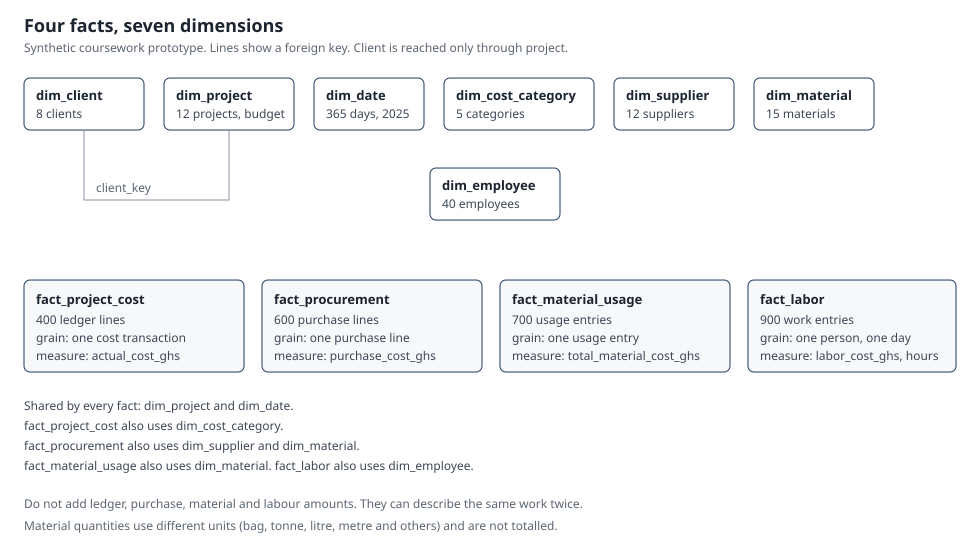

# Rockshell International Ltd. Data Warehouse

Coursework prototype. All company-like rows are **synthetic**. This is not a production system for Rockshell International Ltd. The repository does not include a Power BI report.

The hosted page is being aligned to a smaller star: `dim_project`, `dim_date`, `dim_cost_category`, and `fact_project_cost`. Counts for that simplified database are not verified here. A separate change is updating the database. This repository change does not run SQL.

The coursework package in `coursework4/` is still the earlier galaxy (4 facts and 7 dimensions). An older single-star model is in `archive/star_v1/`. Neither folder is edited by the ledger page.



Live page (hosted prototype, same Cloudflare project `rockshell-dw`):

- https://rockshell-dw.pages.dev
- https://rockshell-dw.afriyierodney64.workers.dev

## Two ways to reproduce the same warehouse

Both paths use the same synthetic files, the same rejection rules and the same verified totals. Pick one for a laptop demo, or use the hosted page if you only need to show the figures.

### 1. Python and SQLite (original coursework package)

Folder `coursework4/`. Standard library only.

```bash
cd coursework4
python build_warehouse.py
```

That script rebuilds `raw_data/*.csv` with random seed 2026, loads `rockshell_warehouse.sqlite`, and writes `outputs/validation.json`, `outputs/rejected_records.csv` and `outputs/project_cost_report.csv`. The committed SQLite file and outputs are that build. `schema.sql` is the SQLite DDL. `analysis_queries.sql` is the budget, supplier and labour queries. It warns that the cost subjects overlap and must not be added.

Checked results from that build:

- finance 403 raw rows to 400 loaded (3 rejected), procurement 603 to 600, material usage 703 to 700, labour 903 to 900
- 2,600 fact rows, 12 rejected rows, 0 foreign-key violations
- dimensions: 8 clients, 12 projects, 12 suppliers, 15 materials, 40 employees, 5 cost categories, 365 dates

### 2. PostgreSQL on Supabase, and the web page on Cloudflare

Hosted database: Supabase project `kthdkdbrokrcokngnfpy`, schema `rockshell` only. Do not point these scripts at another project.

| Path | Role |
|---|---|
| `supabase/migrations/01_cw4_schema.sql` | Tables, foreign keys, checks, indexes, row level security. No policies, so the Data API cannot read the tables. |
| `supabase/migrations/02_cw4_data.sql` | The same rows as the SQLite build, plus the load log and the 13 expected checks. |
| `supabase/migrations/03_cw4_views_api.sql` | Analysis views and `public.rockshell_dashboard()`. |
| `supabase/migrations/04_private_dashboard_api.sql` | Optional. Moves the security definer body into the private schema and leaves a security invoker wrapper with the same public name and the same JSON. Not required for the page. Not applied by this repository. |
| `supabase/checks/04_private_dashboard_api_verify.sql` | Run after migration 04. Confirms the totals and that `anon` still cannot read fact tables. |
| `supabase/loader/load_cw4.py` | Re-applies the Python rules, asserts equality with SQLite and `validation.json`, then rewrites `02_cw4_data.sql`. |

Apply `01`, then `02`, then `03` on an empty schema if you are loading from scratch. Do not re-run `01` on the hosted database: it drops schema `rockshell`. Migration `04` is the only safe follow-up on the database that is already loaded. See `docs/deploy.md` before running it.

The page is one responsive screen. `pages/` is Cloudflare Pages. `dashboard/` is the Worker build of the same screen. The browser calls `GET /api/data`. The server calls the existing read-only RPC with `SUPABASE_KEY` (a Cloudflare secret, not in this repo) and then keeps only ledger fields. If that call fails, the API returns an error and the page does not fill in older figures.

## What the page is showing

Approved budget (once per project), recorded ledger spending, and remaining budget (budget minus ledger). Remaining is not profit and not percent complete. A project with no ledger lines stays on the page with recorded spending of 0. Cost categories appear only when the response includes them. The page does not show procurement, material usage, labour, clients, suppliers, or employees.

`pages/functions/api/ledger_adapter.js` is the only place that chooses fields. `LEDGER_RPC` is still `rockshell_dashboard` until a verified contract supplies a replacement. The current function may still calculate unused subjects inside the database. Those keys are dropped before the browser sees the JSON. This change does not add a table, view, or function, and it does not grant extra database permissions.

The figures above for the coursework package (including GH₵11,426,147.00 budget and GH₵1,900,433.58 ledger) describe `coursework4/` and the earlier hosted load. They are not a contract for the simplified star. Do not treat them as the live page until the database change is verified.

## Security

- Schema `rockshell` is not in the exposed API schemas. Row level security is on for every table. There are no policies. `anon` and `authenticated` have no table grants.
- Views are `security_invoker = true`.
- The only public read path is `public.rockshell_dashboard()` (aggregated JSON). The current hosted function is security definer with `search_path = ''`, which matches the function guide's search_path rule, but Supabase also says a security definer function should not live in an exposed schema.
- Migration 04 follows that second rule: private definer function `rockshell.dashboard_payload()`, public security invoker wrapper, execute granted only to `anon` and `authenticated`, table privileges revoked again. The RPC name and JSON keys stay the same, so the page keeps working. Apply it only on `kthdkdbrokrcokngnfpy`, then run the check script. This change set does not run that SQL.

## Tests

```bash
python pages/test_contract.py
```

That runs `pages/test_ledger_adapter.mjs` (synthetic fixtures: budget counted once, a zero-spend project kept, missing amounts not turned into zero, unused subjects dropped) and checks the page source. The browser check is `pages/test_dashboard.mjs`. It needs Chrome and `puppeteer-core`, which are not project dependencies. Its amounts are fixtures, not the hosted warehouse.

## Deploy

See `docs/deploy.md`. Deploy only to the existing Cloudflare project `rockshell-dw`, after the tests, and without writing secrets into the repo.
