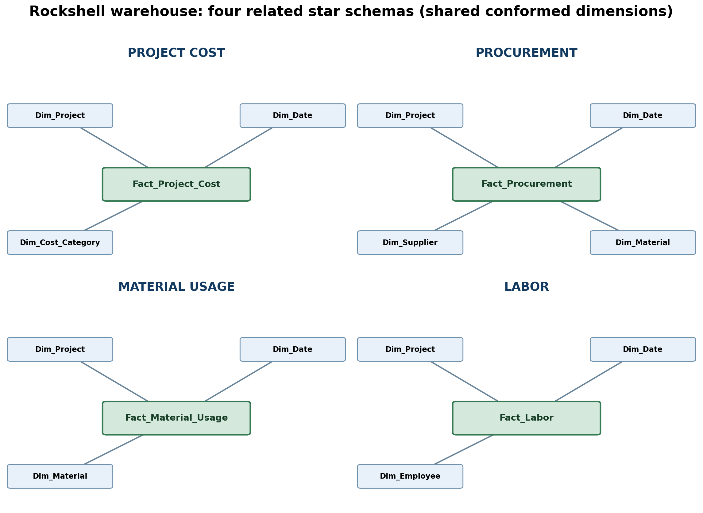

# Rockshell International Ltd. Data Warehouse (Coursework 4)

Live dashboard: **https://rockshell-dw.pages.dev** (Cloudflare Pages) · also https://rockshell-dw.afriyierodney64.workers.dev (Worker)

This repository implements **Coursework 4: Data Design and Preparation for Data Warehousing** for the Rockshell case.
All company-like data is **synthetic** (an academic prototype, not a Rockshell production system).

## Design: a fact constellation (four stars, shared dimensions)

| Fact table | One row represents | Measures | Dimensions |
|---|---|---|---|
| fact_project_cost | One ledger cost transaction | actual_cost_ghs | project, date, cost_category |
| fact_procurement | One purchase line | quantity, unit_price_ghs, purchase_cost_ghs | project, date, supplier, material |
| fact_material_usage | One site material-usage entry | quantity_used, unit_cost_ghs, total_material_cost_ghs | project, date, material |
| fact_labor | One employee work entry for one project/date | hours_worked, hourly_rate_ghs, labor_cost_ghs | project, date, employee |

Dimensions: dim_project (with client link and approved budget), dim_date, dim_supplier, dim_material, dim_employee, dim_cost_category, dim_client (via dim_project).
Surrogate integer keys + unique business IDs, enforced foreign keys, CHECK constraints for non-negative money and positive quantities/hours.

## Folders
- `coursework4/` – the original Coursework 4 sources: report (.docx), `build_warehouse.py`, `schema.sql`, `analysis_queries.sql`, SQLite build, `raw_data/*.csv`, `outputs/` (validation.json, rejected_records.csv, project_cost_report.csv, ERD).
- `supabase/migrations/` – PostgreSQL port deployed to Supabase (schema `rockshell`):
  `01_cw4_schema.sql` (tables, indexes, RLS), `02_cw4_data.sql` (generated data), `03_cw4_views_api.sql` (analysis views + `public.rockshell_dashboard()`).
- `supabase/loader/load_cw4.py` – re-applies the Coursework 4 validation rules to `coursework4/raw_data/*.csv`, asserts the result equals the SQLite build and `validation.json`, then writes `02_cw4_data.sql`.
- `dashboard/` – Cloudflare Worker version; `pages/` – Cloudflare Pages version (same front end).
- `archive/star_v1/` – the earlier single-star design (kept for reference only; no longer deployed).

## Verified results (live warehouse = Coursework 4 report)
- Loads: finance 403→400 (3 rejected), procurement 603→600 (3), material usage 703→700 (3), labour 903→900 (3). **2,600 fact rows loaded, 12 rejected, 0 foreign-key violations.**
- Row counts: clients 8, projects 12, suppliers 12, materials 15, employees 40, cost categories 5, dates 365.
- Budget vs ledger (top 3): P009 777,461.00 / 217,339.21 / 560,121.79 · P003 1,450,763.00 / 212,453.18 / 1,238,309.82 · P005 255,315.00 / 197,866.56 / 57,448.44. All 12 rows equal `outputs/project_cost_report.csv`.
- `rockshell.v_validation` compares 13 expected values from `validation.json` with the live tables (13/13 PASS).

## Views
v_project_budget_vs_ledger, v_supplier_purchases, v_project_labour (mirror `analysis_queries.sql`), v_material_usage, v_monthly_by_subject, v_table_counts, v_validation.
Procurement, material-usage and ledger costs may overlap, so they are reported separately and never added into one total.

## Security
RLS is on for every table, the `rockshell` schema is not exposed through the API, and `anon` has no table privileges. The only public read path is the
SECURITY DEFINER function `public.rockshell_dashboard()` (aggregated JSON), called server-side by the Worker / Pages Function. The Supabase key is a Cloudflare secret, never in this repo.
